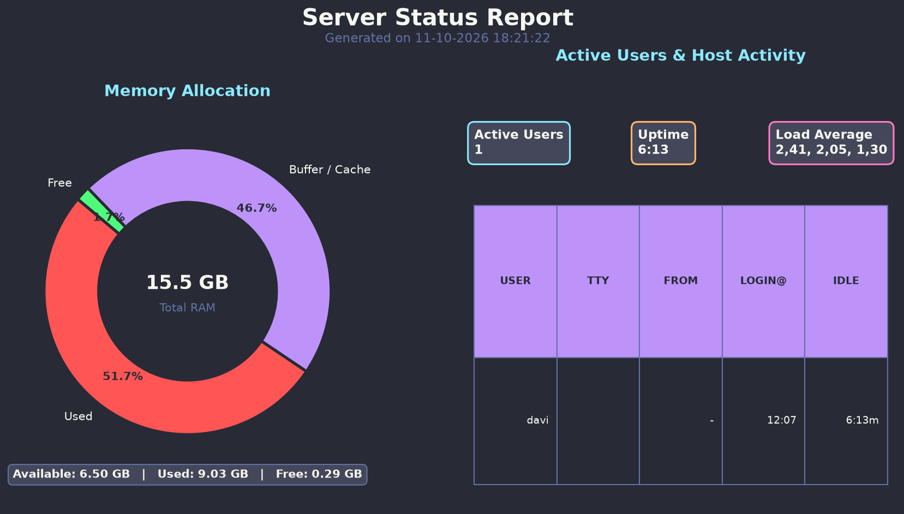

# 🖥️ server-stats

A lightweight Linux server monitoring tool that collects real-time memory and user session data and renders it as a styled PNG report using the [Dracula](https://draculatheme.com/) color theme.



## Features

- **Memory analysis** — collects total, used, free, buffer/cache, and available RAM via `free -m`
- **User session analysis** — parses active sessions, uptime, and load averages via `w`
- **Visual report generation** — produces a `server_report.png` with:
  - A donut chart showing memory allocation (Used / Buffer+Cache / Free)
  - KPI cards for active users, uptime, and load average
  - A session table with user, TTY, origin, login time, and idle time
- Dracula-themed dark background throughout
- Structured logging across all modules
- Accepts both `dict` and plain-string inputs in the report generator (flexible integration)

## Project Structure

```
server-stats/
├── src/
│   ├── main.py                   # Entry point — orchestrates the pipeline
│   ├── analysis/
│   │   ├── __init__.py
│   │   ├── server_memory.py      # Collects and parses memory stats (free -m)
│   │   └── server_users.py       # Collects and parses user sessions (w)
│   └── report/
│       ├── __init__.py
│       └── server_report.py      # Generates the PNG report with matplotlib
├── server_report.png             # Latest generated report (git-ignored in .venv, etc.)
├── LICENSE                       # MIT
├── CHANGELOG.md
└── README.md
```

## Getting Started

### Prerequisites

- Python 3.10+
- Linux (uses `free` and `w` system commands)
- [`matplotlib`](https://matplotlib.org/)

### Installation

```bash
git clone https://github.com/DavisLobo/server-stats.git
cd server-stats
python -m venv .venv
source .venv/bin/activate
pip install matplotlib
```

### Running

```bash
cd src
python main.py
```

The report is saved as `server_report.png` in the current working directory (or wherever `output_path` points). A log line will confirm the path:

```
11/10/2026 - INFO: Report generated at: server_report.png
```

### Programmatic Usage

You can call individual modules or the report generator directly:

```python
from analysis import check_memory, check_users
from report import generate_report

mem  = check_memory()   # dict with RAM stats
usr  = check_users()    # dict with session data
path = generate_report(mem, usr, output_path="my_report.png", show=True)
```

`generate_report` also accepts plain-string summaries produced by the analysis functions, so it can be used standalone without the full pipeline.

## License

This project is licensed under the **MIT License** — see [LICENSE](LICENSE) for details.

